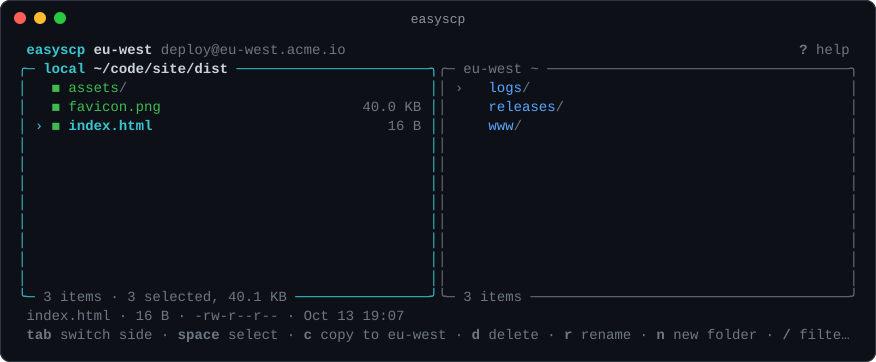

<h1 align="center">easySCP</h1>

<p align="center">
  <b>Send, receive and copy files over SSH by picking them, not typing paths.</b><br>
  One small binary for macOS, Linux and Windows.
</p>

<p align="center">
  <a href="https://github.com/pentoshi007/easySCP/releases/latest"></a>
  <a href="https://www.npmjs.com/package/@pentoshi/easyscp"></a>
  <a href="https://github.com/pentoshi007/easySCP/actions/workflows/ci.yml"></a>
  <a href="LICENSE"></a>
</p>

<p align="center">
  
</p>

## Why easySCP

`scp` makes you remember the user, host, port, key and full path on both ends, every time. Moving a file between two servers is worse: download it, then upload it again to each one.

```sh
scp -P 2222 -i ~/.ssh/deploy deploy@203.0.113.10:releases/app-v2.4.0.tar.gz .
scp -P 2222 -i ~/.ssh/deploy app-v2.4.0.tar.gz deploy@198.51.100.20:releases/
scp -P 2222 -i ~/.ssh/deploy app-v2.4.0.tar.gz deploy@198.51.100.30:releases/
```

With easySCP you save each machine once. After that, run `easyscp copy` and pick everything from menus, or do it in one line:

```sh
easyscp copy build:releases/app-v2.4.0.tar.gz eu-west us-east -t releases
```

## Highlights

- **Pick, don't type.** Fuzzy pickers for local and remote files, with `ctrl+f` to search subfolders. Drag and drop or paste paths if you prefer. Mark several with `space`, or `tab` while you're still typing a search. Folders update as files change (`ctrl+r` refreshes right away), and you can create a new folder while choosing where files go.
- **Server to server.** `copy` reads the source once and uploads to every destination at the same time. The machines don't need to reach each other or have keys for each other.
- **Survives bad connections.** Interrupted transfers resume where they stopped. Files are written to a temporary name and renamed when complete, so you never get a half-written file under the real name.
- **Secure by default.** Host keys are verified, passwords and passphrases live in the OS keychain, and your `~/.ssh/config` works, including `ProxyJump`.
- **Two-pane browser.** Copy, rename, delete and create folders on your computer and the server side by side.
- **No setup.** A standalone binary with nothing else to install. Tab completion sets itself up, and `easyscp update` keeps it current.
- **Scriptable.** Every prompt has a flag, and without a terminal easyscp never prompts.

## Install

```sh
# macOS and Linux
curl -fsSL https://github.com/pentoshi007/easySCP/releases/latest/download/install.sh | sh

# Windows (PowerShell)
irm https://github.com/pentoshi007/easySCP/releases/latest/download/install.ps1 | iex

# Homebrew
brew install pentoshi007/tap/easyscp

# npm (Node.js 22 or newer)
npm install -g @pentoshi/easyscp
```

The install scripts download the binary for your platform, check it against the release checksums, add it to your `PATH` and set up tab completion. Set `EASYSCP_INSTALL_DIR` to choose the folder or `EASYSCP_VERSION` to pin a version. Binaries for x64 and arm64 are also on the [releases page](https://github.com/pentoshi007/easySCP/releases).

You get two commands, `easyscp` and the shorter `escp`.

## Quick start

```sh
easyscp add            # save a machine, or `easyscp import` from ~/.ssh/config
easyscp send prod      # pick local files, then a remote folder
easyscp get prod       # pick remote files, then a local folder
easyscp copy           # copy from one machine to others
easyscp browse prod    # two-pane file browser
easyscp                # menu with everything above and your recent transfers
```

Leave out an argument and easyscp asks for it. Pass everything to skip the questions:

```sh
easyscp send prod ./dist -t /var/www --overwrite
easyscp send ./dist web1 web2:/srv/app -t /var/www
easyscp get prod '/var/log/*.log' -t ./logs
easyscp copy web1:/srv/app.tar web2 web3:/opt -t /srv
```

<p align="center">
  
</p>

## Commands

| Command | Aliases | Purpose |
| --- | --- | --- |
| `send [machine[:folder]...] [files...]` | `up`, `push`, `upload` | Upload files or folders to one or more machines |
| `receive [machine] [paths...]` | `get`, `down`, `pull`, `download` | Download files or folders |
| `copy [from[:paths]] [to[:folder]...]` | `cp`, `relay` | Copy from one machine to others |
| `browse [machine]` | `open`, `files` | Two-pane file browser |
| `add [user@host[:port]]` | `new` | Save a machine |
| `edit [name]` | | Change a saved machine |
| `remove [name...]` | `rm`, `delete` | Forget saved machines |
| `list` | `ls`, `hosts` | Show saved machines (`--json`) |
| `test [name]` | `ping`, `check` | Check that you can connect and log in |
| `import` | | Import machines from `~/.ssh/config` |
| `history` | `log` | Recent transfers, pick one to run again (`--json`, `--clear`) |
| `update` | `upgrade` | Update easyscp the way it was installed |
| `completion [install\|uninstall\|<shell>]` | | Manage tab completion for bash, zsh, fish or PowerShell |

Transfer flags: `-t, --to <dir>` sets the destination folder. `--overwrite`, `--skip`, `--newer`, `--rename` and `--resume` decide what happens when a file already exists. `-y, --yes` accepts the defaults. Run `easyscp <command> --help` for details.

<details>
<summary><b>Scripting and exit codes</b></summary>

<br>

Without a terminal, easyscp never prompts. It prints plain text, writes errors to stderr and exits with:

| Code | Meaning |
| --- | --- |
| `0` | Success |
| `1` | Error or partial transfer |
| `2` | Invalid usage |
| `130` | Cancelled |

</details>

<details>
<summary><b>Tab completion</b></summary>

<br>

The first time you run easyscp in a terminal, it sets up completion for your shell and tells you where. It adds a marked block to your shell profile that loads a script easyscp keeps up to date.

```sh
easyscp completion install [shell]    # set it up again, or for another shell
easyscp completion uninstall          # remove it and stop setting it up
easyscp completion zsh                # print the script to manage it yourself
```

</details>

<details>
<summary><b>Environment variables</b></summary>

<br>

| Variable | Effect |
| --- | --- |
| `EASYSCP_HOME` | Where machines, history and host keys are stored (default `~/.config/easyscp`, `%APPDATA%\easyscp` on Windows) |
| `EASYSCP_SECRETS=file` | Store secrets in a private file instead of the OS keychain |
| `EASYSCP_DEBUG=1` | Write an SSH debug log to `debug.log` in the easyscp folder |
| `EASYSCP_ASCII=1` | Use ASCII symbols only |
| `EASYSCP_NO_COMPLETION=1` | Don't set up tab completion automatically |
| `EASYSCP_NO_UPDATE_CHECK=1` | Don't check for new releases |
| `NO_COLOR` | Disable colors |

When no OS keychain is available, secrets go to a file that only your user can read. Treat that file like a private key.

</details>

<details>
<summary><b>Development</b></summary>

<br>

```sh
git clone https://github.com/pentoshi007/easySCP.git && cd easySCP
npm ci
npm run check           # typecheck, lint and tests
npm run dev             # rebuild dist/ on change
npm install -g .        # use your build as easyscp
npm run build:binary    # standalone binary in release/ (needs Node.js 25.5+)
```

Pushing a `v*` tag that matches `package.json` builds and tests the binaries on every platform, then publishes to npm, GitHub Releases and the Homebrew tap.

</details>

## Contributing

Bug reports, ideas and pull requests are welcome in [issues](https://github.com/pentoshi007/easySCP/issues). If easySCP saves you some typing, a star helps other people find it.

## License

[MIT](LICENSE)
